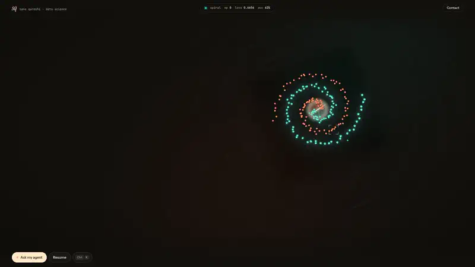

# Train Me Live

A portfolio template for data scientists and ML engineers, laid out as a machine learning notebook. It opens with a real neural network training live in the visitor's browser, and every section after it is a notebook cell with its own 3D scene built from that same model. The demo person, Sana Qureshi, and her companies, projects and papers are fictional: replace them with your own in one file.

<p align="center">
  <a href="docs/preview.mp4"></a>
  <br>
  <sub>Click the preview to watch the full 40-second video (<code>docs/preview.mp4</code>).</sub>
</p>

**Use it:** click **Use this template** at the top of this page (or run `git clone https://github.com/Malaydoshi711/live-training-portfolio-template.git`), then follow [Quick start](#quick-start) and [Make it yours](#make-it-yours) below. Everything you need to change lives in `src/data/content.ts`.

## Features

- **A real model, trained on the visitor's device.** `src/ml/` is a small multilayer perceptron written from scratch in TypeScript: 2 inputs, two tanh hidden layers, a sigmoid output, binary cross-entropy, backpropagation and the Adam optimiser, all in flat typed arrays. No ML library.
- **Its decision boundary is the hero.** Three.js renders p(class B) over the input plane as a sculpted heightfield: one class becomes a plateau, the other a valley, and the glowing line is the p = 0.5 boundary. Data points are spheres; misclassified ones blink. Loss curve, epoch, accuracy and weight count sit in the console and in the top bar.
- **Interactive.** Click or tap the surface to drop a point (Shift for the other class) and watch the boundary bend around it. Switch between spiral, moons and circles, change hidden units (4, 8, 16, 32) and learning rate, pause, reset the weights or clear your points.
- **Every section is a notebook cell with its own 3D moment, built from the live model:**
  1. About: the network you just trained, every weight drawn as an edge (colour = sign, brightness = size) with forward-pass pulses.
  2. Experience ("Training log"): this session's real loss curve on a log scale, with your career checkpoints pinned along it.
  3. Flagship project: its parts as a computation graph with a packet walking the pipeline and a shared hub underneath; an interactive SVG version sits in the cell.
  4. Projects: a live confusion matrix of the model, extruded as blocks. Each project card has a small output panel (gauge, before and after bars, counts, a pipeline, a graph, a code snippet) chosen per project in content.
  5. Research: papers and talks as standing sheets, award winners framed in gold. The section hides itself when you have none.
  6. Toolkit: what each unit of hidden layer 2 has learned, as activation maps. Skills read like imports; certifications are a `DataFrame.head()`.
  7. Contact: the camera rises over the finished model.
- The camera orbits the surface between cells and the surface colours shift per section. Training runs only while the hero is on screen and the tab is visible.
- A kernel-boot loader and cinematic intro, Lenis smooth scrolling with GSAP ScrollTrigger reveals, a crosshair cursor, a Ctrl/Cmd + K command palette, and an "Ask my agent" console.

## Quick start

Requires Node 20.19+ or 22.12+ (Node 22 LTS recommended).

```bash
npm install
npm run dev        # http://localhost:5173
npm run build      # type-check and production build into dist/
npm run preview    # serve the production build
npm run test:ml    # gradient check and convergence tests for the MLP
```

## Make it yours

1. **Edit `src/data/content.ts`.** It is the only file with personal content. Its exports:
   - `site`: URL, page title, description, locale, share image, resume path and download name, the wordmark next to your initials, theme colour, footer note, optional X handle.
   - `profile`: name (and how it breaks over two lines in the hero), initials, role, company, location, email, intro, About headline and paragraphs, social links (`"#"` or `""` hides a button).
   - `education`: degree and school, shown in About and known to the agent.
   - `experience`: jobs, newest first (one to five work well).
   - `featured`: your flagship project. `parts` (two to six) become the computation graph in the cell and in 3D; `hub` is the shared layer underneath; `input` and `output` label the two ends.
   - `projects`: each has an optional `viz` that picks its output panel. The `Viz` type above the array lists every option (`gauge`, `number`, `bars`, `compare`, `count`, `steps`, `hub`, `code`, `none`); leave it out and a sensible default is used.
   - `publications`: papers and talks (`kind: "Talk"`), with an optional `award`. An empty array hides the section, its nav entry and its 3D scene.
   - `skills`, `certifications`, `contact` (heading and lead), `agent` (suggested questions and the pronoun the agent uses).
2. **Set `site.url`** to your domain (with a trailing slash). It fills the canonical link, Open Graph tags, JSON-LD, `robots.txt` and `sitemap.xml`, which are all generated by the `siteMeta` plugin in `vite.config.ts`.
3. **Resume:** replace `public/Resume.pdf` (or point `site.resume` at another file in `public/`).
4. **Share image:** replace `public/og.png` with a 1200x630 image. The easiest way: run `npm run dev`, open the site in a 1200x630 window, wait for the intro to finish, and take a screenshot of the hero.
5. **Favicon:** edit the initials in `public/favicon.svg`, and replace `public/apple-touch-icon.png` (180x180).
6. **Colours and fonts:** the CSS variables at the top of `src/styles.css`, plus the same colours in `src/theme.ts` for the 3D world and canvas text (`SECTION_COLORS` sets the surface colours per section). Fonts are Fontsource packages imported in `src/main.tsx`; the 3D labels use the same families in `src/world/labels.ts`.
7. **Remove the fictional footer note:** set `site.footerNote` to `""`.
8. **Optional:** turn on LLM answers for the agent (below).

## How "Ask my agent" works

The console answers questions about you from `content.ts` with no server. `src/agent/kb.ts` turns the content into small text chunks, a BM25 retriever with a synonym list finds the best matches, and an extractive answer is written from them. The visible trace (Query, Retrieve, Reason, Respond) shows each step. Suggested questions come from `agent.suggestions`.

To make answers generative, deploy to Vercel and set these environment variables, then redeploy:

| Variable | Example | Notes |
|---|---|---|
| `VITE_LLM` | `1` | tells the browser to call `/api/ask` |
| `LLM_API_KEY` | your Groq or OpenAI key | required |
| `LLM_BASE_URL` | `https://api.groq.com/openai/v1` | optional, any OpenAI-compatible API |
| `LLM_MODEL` | `llama-3.3-70b-versatile` | optional |

`api/ask.ts` (a Vercel Edge Function) retrieves context on the server with the same knowledge base, builds its system prompt from `content.ts`, rate limits per IP, and the browser falls back to offline answers on any error. Locally, `POST /api/ask` answers 501 from a small Vite middleware, so the offline answers are used.

## Deploy

- **Vercel:** push the folder to a Git repository, import it on vercel.com (framework preset Vite, build `npm run build`, output `dist`), then add your domain under Settings, Domains. `vercel.json` sets cache and security headers. Web Analytics works if you enable it in the dashboard; the component only loads in production and not on localhost.
- **Netlify:** build command `npm run build`, publish directory `dist`.
- **Any static host:** upload `dist/` after `npm run build`. The agent then uses its offline answers only.

## Performance and accessibility

- Quality adapts automatically: if frames stay slow, bloom turns off and then the resolution drops. Phones get a coarser grid, no bloom and a lighter scene.
- Training is capped per frame and pauses when the hero is off screen or the tab is hidden; the surface grid is evaluated in chunks under a time budget.
- With `prefers-reduced-motion` there is no smooth scroll and no intro animation; the hero shows an already trained model with a Train button, and all content is visible at once.
- Without WebGL the same live training is drawn as a 2D heatmap and every section stays readable.
- The page works with the keyboard (skip link, focus styles, Esc closes dialogs) and the 3D canvas is hidden from screen readers.

## Project structure

```
src/data/content.ts      all personal content (start here)
src/theme.ts             colours for the 3D world and canvas text
src/styles.css           layout and CSS colour/font variables
src/App.tsx              sections, HUD, scroll choreography, boot sequence
src/components/          Loader, Console, MetricViz (project panels), Pipeline (flagship graph), Agent, Palette, Cursor
src/ml/                  the from-scratch MLP, datasets, trainer and shared run state
src/world/World.ts       Three.js scene, decision surface, camera path, bloom, adaptive quality
src/world/moments.ts     per-section 3D moments driven by the model and content
src/world/Flat.ts        2D fallback when WebGL is missing
src/agent/kb.ts          knowledge base, retrieval and answers for the agent
api/ask.ts               optional LLM endpoint (Vercel Edge Function)
vite.config.ts           fills index.html, robots.txt and sitemap.xml from content.ts
tests/ml.test.ts         gradient check and convergence tests
public/                  Resume.pdf, og.png, favicon.svg, apple-touch-icon.png
```

## Credits

Built with [Three.js](https://threejs.org), [GSAP](https://gsap.com), [Lenis](https://lenis.darkroom.engineering), [React](https://react.dev) and [Vite](https://vitejs.dev). Fonts (Instrument Serif, Instrument Sans, JetBrains Mono) from [Fontsource](https://fontsource.org).

## License

MIT, see [LICENSE](LICENSE). You are free to use this template for your own portfolio, change it and publish it. The demo person, companies and projects are fictional.
